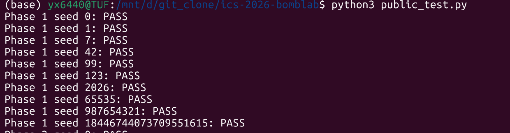
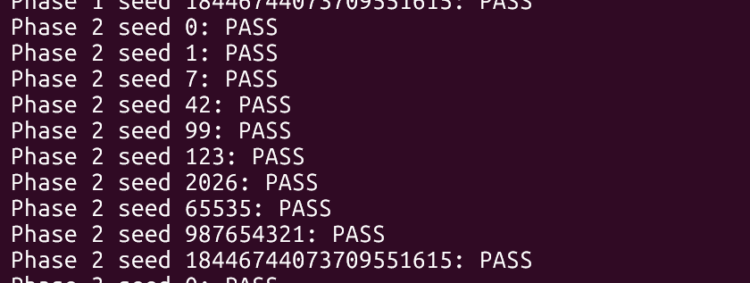
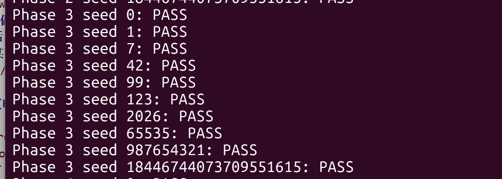
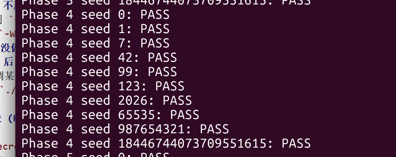
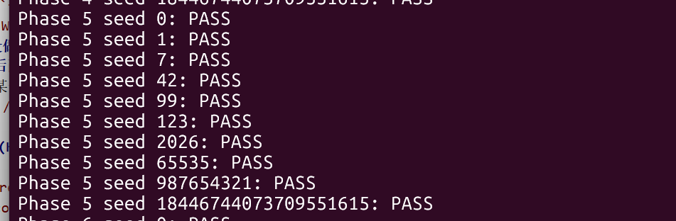
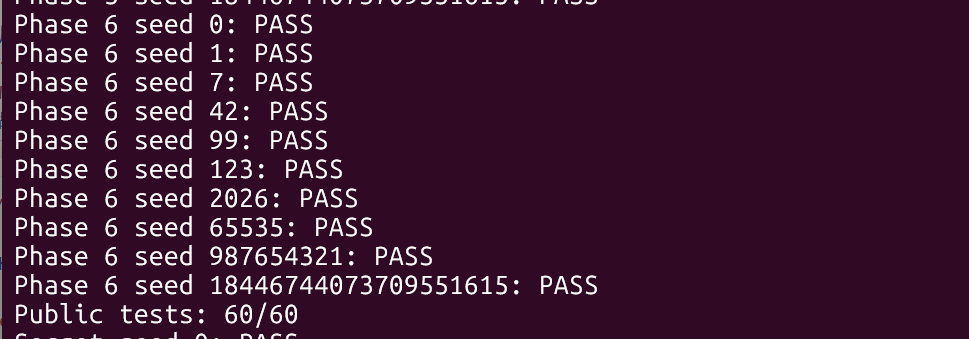
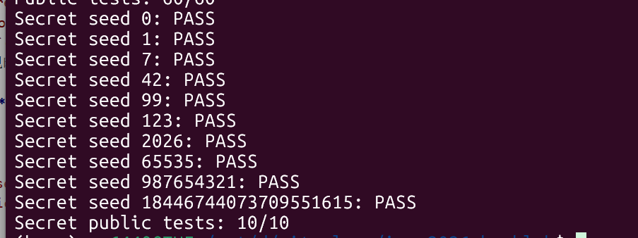
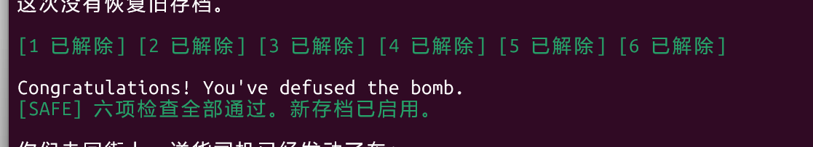

# BombLab 实验报告


## 关卡分析

### 第 1 关：函数调用与参数传递

`phase_01` 用 `mov $0x1,%esi` 指定一项无符号整数，并在 `call p1_compute` 后用 `cmp %eax,...` 比较输入。`p1_compute` 依次调用三个辅助函数。关键指令包括 `shr $0x20,%rax`、`shr $0x10,%rdx`、`xor $0x2720,%esi`、`lea (%rsi,%rdi,2),%eax`、`sub %esi,%edi` 和 `lea 0xa79c(%rdi,%rdi,4),%eax`。由参数传递顺序可得：

```text
L = u32(C), M = u32(C >> 16), H = u32(C >> 32)
step2 = (L + 0x47c7) ^ H
step0 = (M ^ 0x2720) + 2L
answer = 5(step0 - step2) + 0xa79c
```

这里的 `M` 是右移 16 位后的低 32 位，不是单独的 16 位字段。`lea` 同时完成乘法与加法，不能按取地址操作理解。求解函数输出一个整数。



### 第 2 关：数组与循环

`phase_02` 的 `mov $0x6,%esi` 与 `cmp $0x6,%eax` 确定口令有六项。首项比较前有 `shr $0x2`、`and $0x3f`、`add $0x1`；循环中依次出现前项加倍、`shr %cl`、`and $0xf`、`xor`，随后把递增的 `0xd` 倍数相加。设六项为 $a_0,\ldots,a_5$：

```text
a0 = u32((C >> 2) & 0x3f) + 1
for i = 1..5:
    nibble = u32((C >> (23+i)) & 0xf)
    ai = ((2 * a(i-1)) ^ nibble) + 13*i
```

汇编循环的位移计数从 `0x18` 开始，到 `0x1c` 结束，分别对应 `i=1..5`。实现时先用前一项算出期望值，再写入当前项。



### 第 3 关：跳转表

`phase_03` 先将 challenge 的低三位与第一项比较，之后把 `u32(C >> 3) ^ u32(C >> 32)` 交给 `p3_dispatch`。`p3_dispatch` 的 `notrack jmp *0x405820(,%rax,8)` 表明第二项由八项跳转表选择。读取该表后，选择器 \(s=C\&7\) 与函数的对应关系为 `4,5,2,7,6,3,0,1`，不能直接按函数名后缀排序。令 `v = u32(C >> 3) ^ u32(C >> 32)`，第二项如下：

| 第一项 `s` | 第二项 `f(s,v)` | 实际函数 |
| --- | --- | --- |
| 0 | `(4v) ^ 0x1e1d` | `p3_case_4` |
| 1 | `(v ^ 0xe542) + (v >> 2)` | `p3_case_5` |
| 2 | `5v + 0x3c09b` | `p3_case_2` |
| 3 | `5v + 0x1fa3b` | `p3_case_7` |
| 4 | `5v + 0x14e0` | `p3_case_6` |
| 5 | `5v + 0x7999` | `p3_case_3` |
| 6 | `(2v) ^ 0x520f` | `p3_case_0` |
| 7 | `(v ^ 0xd43d) + (v >> 2)` | `p3_case_1` |

输出为 `s f(s,v)` 两个无符号整数。表中右移针对 32 位无符号数。



### 第 4 关：递归返回值

`phase_04` 用 `and $0x7f,%edi` 取目标 \(t\)，并从 `C >> 7` 与 `C >> 32` 的低 32 位异或得到盐值 \(q\)，调用 `p4_walk(t,0,127,q)`。在 `p4_walk` 中，`sub`、`shr $1`、`add` 求中点；`jb` 决定向左递归；`lea (%rax,%rax,4),%eax` 把子调用返回值乘五。恢复出的递归关系为：

```text
mid = low + ((high - low) >> 1)
if t == mid: return (mid + 0x47) ^ q
if t < mid:  return (5 * walk(t, low, mid-1, q) ^ (mid+q)) ^ 0x7
else:        return (5 * walk(t, mid+1, high, q) ^ (mid+q)) ^ 0x1e
```

返回值是唯一的口令整数。左右分支在递归结果组合阶段使用不同常量，因此只判断找到目标的中点还不够。



### 第 5 关：链表布局与遍历

`phase_05` 要求两个整数。`p5_traverse` 从 `p5_heads[C & 7]` 取链表起点，`(C >> 3) & 3` 决定后续移动次数。`mov (%rdx),%rdx` 沿节点指针移动；`mov 0x8(%rdx),%esi` 读取节点值；`add 0xc(%rdx),%eax` 使用节点盐值。节点每个占 16 字节，偏移 `0` 为下一节点指针，偏移 `8` 为 `value`，偏移 `12` 为 `salt`。

将 `p5_nodes` 按地址从低到高编号为 0–11，`p5_heads` 对应的起点编号为 `[6,1,4,7,3,0,11,2]`。从内存表读取的数据如下，`-1` 表示空指针：

| 编号 | next | value | salt |
| ---: | ---: | ---: | ---: |
| 0 | 11 | `0x412` | `0x5140` |
| 1 | 4 | `0x782` | `0x5578` |
| 2 | 5 | `0x626` | `0x173e` |
| 3 | 0 | `0x90a` | `0x4c3a` |
| 4 | 7 | `0x27a` | `0x17c9` |
| 5 | 10 | `0x134` | `0x66e9` |
| 6 | 1 | `0xa45` | `0x2764` |
| 7 | 3 | `0x4f` | `0xc4ba` |
| 8 | -1 | `0x83a` | `0xf613` |
| 9 | 8 | `0xb5b` | `0xc9d8` |
| 10 | 9 | `0x52c` | `0x50bc` |
| 11 | 2 | `0x37e` | `0x94ad` |

初值及遍历关系为：

```text
acc = u32(C >> 6) ^ u32(C >> 32) ^ 0x6645
node = heads[C & 7]
steps = (C >> 3) & 3
对起点及之后的 steps 个节点逐一执行：
    acc = (3 * acc + node.salt) ^ node.value
    last_value = node.value
    若还需继续，node = node.next
```

第一项是最终 `acc`，第二项是最后访问节点的 `value`。汇编中返回寄存器 `eax` 与输出指针 `rsi` 对应这两个结果；即使 `steps=0`，起点节点仍须处理一次。



### 第 6 关：函数指针表与间接调用

`p6_dispatch` 的两次 `call *0x405e00(...)` 分别按 `C & 7` 和 `(C >> 3) & 7` 索引 `p6_ops`。从表中读到的操作编号顺序为 `[1,4,1,0,5,2,5,3]`。`p6_op_1` 的 `rol $0x5` 是 32 位循环左移五位，`p6_op_4` 的 `ror $0x3` 是 32 位循环右移三位。各操作为：

| 编号 | `op(x)` |
| ---: | --- |
| 0 | `(x ^ 0xd738) + 8x` |
| 1 | `rol32(x,5) ^ 0xc8ab` |
| 2 | `((x << 5) + 0xa982) ^ (7x)` |
| 3 | `(x + 0x9835) ^ (x >> 3)` |
| 4 | `ror32(x,3)` |
| 5 | `((x >> 2) ^ x) + 0x1ed1` |

先令 `x = u32(C >> 6) ^ u32(C >> 32)`，然后按表进行第一次操作，对结果异或 `0xc04f`，再按第二个索引操作，最后加 `0x23de`。最终值是唯一的口令整数。




## Honor 关分析

Honor 的输入还依赖前六关口令构成的 `context`。`secret_gate` 调用 `secret_copy` 后比较 `-0xb0(%rbp)` 与 `0x4e45504f`。局部字符区从 `-0xd0(%rbp)` 起，距检查标记 32 字节；按小端序，`0x4e45504f` 对应 `OPEN`。因此前 32 字节可作填充，第 33–36 字节须为 `OPEN`。`secret_phase` 从 `-0xac(%rbp)` 开始读三个无符号整数，即从这 36 字节之后解析。当前实现输出 32 个 `A`、`OPEN`，紧接三个整数。

`secret_phase` 中 `and $0x3,%ecx` 指定首项；`secret_mix` 用 `rol $1`、`add $0xa884`、`xor $0x2a2` 混合数据。设 \(K\) 为 context，并令：

```text
cf = u32(C) ^ u32(C >> 32)
kf = u32(K) ^ u32(K >> 32)
first = u32(K) & 3
mix(x) = (rol32(x,1) + 0xa884) ^ 0x2a2
second = mix(cf ^ kf) ^ ((first * 0xa884) ^ u32(K >> 16))
third = second ^ (0x2a2 + kf + first + (cf >> 1))
```

注意 `cf >> 1` 是 32 位无符号右移。第七行由前缀和 `first second third` 组成；`defuser --secret --seed ...` 会先计算前六行，再将它们形成的 context 传给 `solve_secret`。




## 运行验证

使用 Ubuntu WSL，在仓库根目录执行 `make` 与 `python3 public_test.py`。2026 年 10 月 15 日复测结果为第 1–6 关 **60/60**，Honor **10/10**。现有截图分别显示各关十个公开 seed 的 `PASS`；公开列表见 `tests/public.json`。

为满足公开列表之外的 seed 验证，另外使用 **314159** 与 **1234567**。执行 `./defuser --seed 314159 | ./bomb --seed 314159` 和对应的 `1234567` 命令，两次运行均依次出现 `Phase 1 defused.` 至 `Phase 6 defused.`，最后显示 `Congratulations! You've defused the bomb.`。两个 seed 的 Honor 还按 `public_test.py` 的 `check_seed` 过程复测：先提交前六行，再附加 `./defuser --secret --seed ...` 生成的第七行；两个检查均返回 `None`。记录如下：

| seed（均不在公开列表） | 第 1 关 | 第 2 关 | 第 3 关 | 第 4 关 | 第 5 关 | 第 6 关 | Honor |
| ---: | :---: | :---: | :---: | :---: | :---: | :---: | :---: |
| 314159 | 通过 | 通过 | 通过 | 通过 | 通过 | 通过 | 通过 |
| 1234567 | 通过 | 通过 | 通过 | 通过 | 通过 | 通过 | 通过 |

例如 seed `314159` 时，六行口令依次为：

```text
2602068835
48 109 244 519 1078 2211
5 3412686145
1397144646
1245213301 2314
2508853027
```

该 seed 的 Honor 行由 `defuser --secret` 生成；口令中的整数会随 seed 和 context 改变。




## 参考资料、工具与复核说明

- 仓库 `tutor/README.md`：反汇编、GDB 查看参数和内存的方法。
- Codex：辅助解释了部分汇编代码并参与修缮 `defuser.c` 的实现，也辅助整理本报告。
